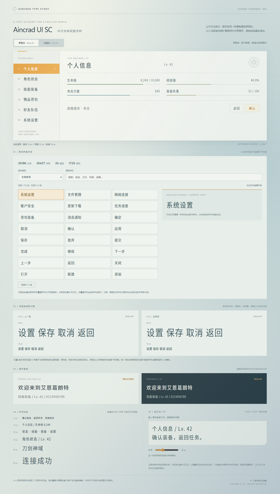
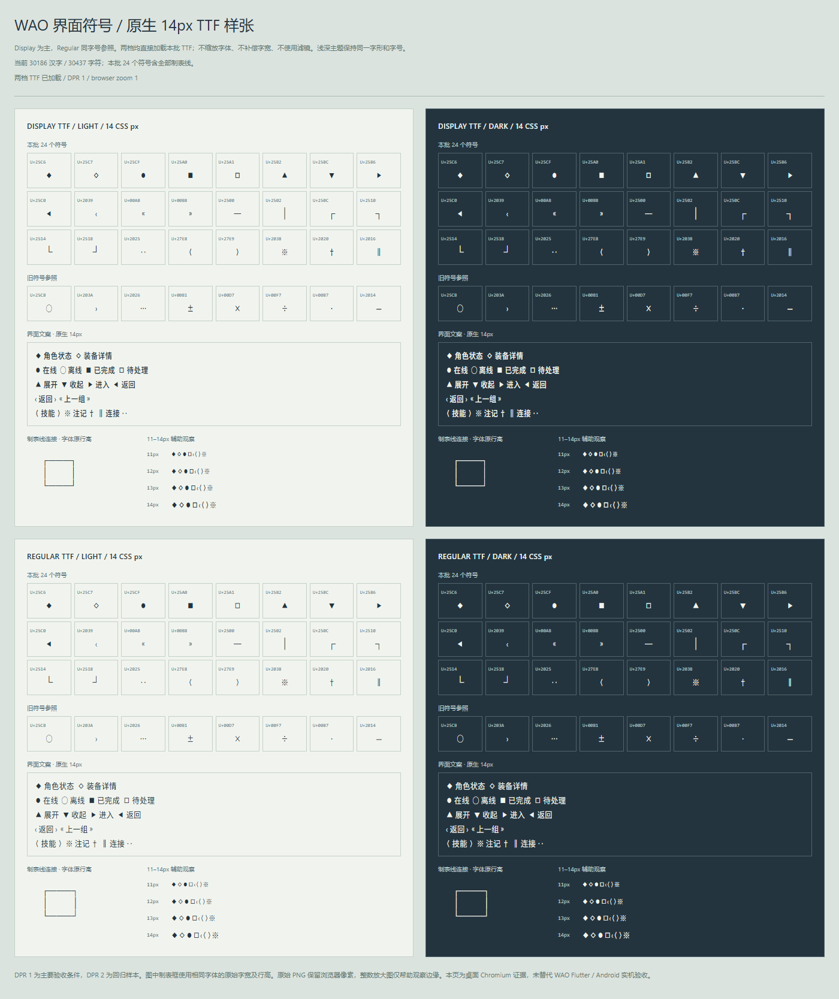

# 艾恩葛朗特字体 · Aincrad UI SC

**A condensed Chinese UI typeface with an SAO-inspired character.**

English · [简体中文](README.zh-CN.md) · [Download v0.3.0](https://github.com/kymorphius/Aincrad-UI-SC/releases/tag/v0.3.0)



艾恩葛朗特字体 (Aincrad UI SC) derives from **Source Han Sans SC v1.004**. Condensed proportions, restrained rounding and chamfered corners come in two styles: **Regular** for interface text and **Display** for headings. This edition covers **30,437 encoded characters**: all **30,186 Han codepoints** mapped by the project's local Source Han inputs, plus **251 Latin letters, digits, punctuation and other symbols**.

The **`wao-symbols`** edition completes all 24 symbols requested for the WAO interface, including the six box-drawing characters:

```text
◆◇●■□▲▼▶◀‹«»─│┌┐└┘‥⟨⟩※†‖
```

## Download

Get the fonts from [GitHub Release v0.3.0](https://github.com/kymorphius/Aincrad-UI-SC/releases/tag/v0.3.0).

| Use | Download or file |
| --- | --- |
| Complete distribution: fonts, source subsets, charset, specimens and rebuild tools | [Aincrad-UI-SC-v0.3-wao-symbols.zip](https://github.com/kymorphius/Aincrad-UI-SC/releases/download/v0.3.0/Aincrad-UI-SC-v0.3-wao-symbols.zip) |
| WAO integration: both TTFs, application charset, license and replacement instructions | [Aincrad-UI-SC-v0.3-wao-handoff.zip](https://github.com/kymorphius/Aincrad-UI-SC/releases/download/v0.3.0/Aincrad-UI-SC-v0.3-wao-handoff.zip) |
| Interface text | `AincradUISc-Regular.ttf` or `.otf` |
| Headings | `AincradUISc-Display.ttf` or `.otf` |
| Web embedding | The corresponding `.woff2` files |
| Exact character list | [`data/charset.json`](data/charset.json) |

The complete distribution is **158,164,747 bytes** (about 158 MB); the WAO handoff is **14,424,628 bytes** (about 14 MB). Each ZIP has a separate `.zip.sha256` file. [`SHA256SUMS`](https://github.com/kymorphius/Aincrad-UI-SC/releases/download/v0.3.0/SHA256SUMS) covers the release assets. The release tag is **`v0.3.0`**, the edition is **`wao-symbols`**, and the internal font version remains **0.300**.

Download the accompanying [OFL.txt](https://github.com/kymorphius/Aincrad-UI-SC/releases/download/v0.3.0/OFL.txt) with any standalone font file.

## Install and use

1. Install **either TTF or OTF for each style** with your operating system's font manager. Use WOFF2 in web projects.
2. Select `Aincrad UI SC` or `Aincrad UI SC Display` in your application.
3. After replacing an earlier version, reopen applications that use the font to refresh their caches.

Use Regular primarily for interface text, lists and controls, and Display for headings. Digits have equal advances within each style by default.

For WAO, replace the TTF assets and `assets/fonts/aincrad-ui-sc-charset.json`, keeping filenames and Flutter font declarations consistent. Then run the application's `test/font_coverage_test.dart` and inspect its UI. The font workspace has **not run the WAO Flutter/Android application tests**.

## Web use

Place the WOFF2 files in your site's `fonts` directory:

```css
@font-face {
  font-family: "Aincrad UI SC";
  src: url("./fonts/AincradUISc-Regular.woff2") format("woff2");
  font-weight: 400;
  font-style: normal;
  font-display: swap;
}

@font-face {
  font-family: "Aincrad UI SC Display";
  src: url("./fonts/AincradUISc-Display.woff2") format("woff2");
  font-weight: 400;
  font-style: normal;
  font-display: swap;
}

body {
  font-family: "Aincrad UI SC", "Microsoft YaHei", sans-serif;
}

h1, h2, .display-text {
  font-family: "Aincrad UI SC Display", "Microsoft YaHei", sans-serif;
  font-weight: 400;
}
```

## Character coverage

| Scope | Count |
| --- | ---: |
| Han codepoints | **30,186** |
| Latin letters, digits, punctuation and other symbols | **251** |
| Total encoded characters | **30,437** |
| Compatibility ideographs within the Han total | 421 |
| Supplementary-plane characters within the Han total | 2,293 |
| New interface symbols in this edition | 24 |

Both GB2312 Han levels, previous application additions and all **64 hexagram symbols** remain included. Compatibility ideographs retain their original Unicode codepoints. This edition adds **no Han characters or new manual Han refinement plans**.

“All Han” means the unified and compatibility ideographs actually mapped by the local **Source Han Sans SC v1.004** inputs. It does not mean the latest Source Han release, every Unicode Han character or every character in the source fonts. See [`data/source-font-coverage.json`](data/source-font-coverage.json) for the exact scope.

## Specimens and verification



The main symbol specimen uses **Display TTF at 14 CSS px / DPR 1**, with Regular at the same size, light/dark themes and a DPR 2 regression. A [six-times nearest-neighbor enlargement](media/wao-symbols-zoom-dpr1.png) preserves the native DPR 1 pixels for inspection. Representative Han specimens remain available in [the 14px Han sample](media/sourcehan-samples.png).

This edition passed the general and independent symbol checks:

- All six output fonts cover **30,437 characters**. The **30,413 previously encoded characters** retain their vector outlines, complete horizontal metrics and line metrics; existing TrueType coordinates, flags, contour endpoints and instructions are also preserved.
- All 24 new symbols produce visible ink within the line cell at 14px and 28px in all six formats. The three navigation/bracket pairs have zero measured mirror error, and all six box-drawing glyphs reach their specified connection boundaries.
- Desktop Chromium checks confirmed actual TTF loading without fallback at DPR 1 and 2, including **256 single-character font-attribution checks**, HUD text and box frames. Existing 11–14px specimens and representative Han samples were refreshed with the current fonts.
- An independent complete rebuild produced byte-identical copies of **all 15 font files and the charset**: seven generated files and eight historical comparison fonts.

The box frames connect using the font's original advances and line height. **DPR 1 antialiasing leaves faint cell-junction seams and colored edge pixels**, retained in the specimens; custom letter spacing or line height changes the joins. Dense Han can remain crowded at small sizes. These samples are not an all-character optical acceptance test or a substitute for Flutter/Android testing.

Reports: [`data/verification.json`](data/verification.json), [`data/wao-symbol-verification.json`](data/wao-symbol-verification.json), [`data/wao-symbol-browser-verification.json`](data/wao-symbol-browser-verification.json) and [`data/wao-package-rebuild.json`](data/wao-package-rebuild.json). Earlier Source Han expansion raster differences remain documented separately in [`data/sourcehan-raster-diagnostics.json`](data/sourcehan-raster-diagnostics.json); they are historical evidence, not the status of this symbol edition. No all-size pixel-identity claim is made.

Open `specimen.html` to search and try text, or `wao-symbols-study.html` for the symbol specimen. The complete distribution also contains 30 full-Han coverage sheets per style and the 11–14px specimens. See [`WAO-SYMBOLS.md`](WAO-SYMBOLS.md) for this edition's delivery record.

## Rebuild

The complete distribution includes ten source subsets and fourteen build, verification and preview scripts. From its extracted directory:

```powershell
python -m pip install -r requirements.txt
python scripts/build_aincrad_font.py
python scripts/verify_aincrad_font.py --report data/verification.json
```

A normal rebuild and general verification need no external TTC, previous ZIP or browser. Full independent provenance/regression checks additionally use the original TTC inputs and previous release archive; browser previews require Playwright/Chromium. See [`BUILD.zh-CN.md`](BUILD.zh-CN.md) for detailed build notes. Verification records retain local and temporary paths as provenance; normal rebuilds do not depend on those directories.

## Source and license

Upstream typeface: [Adobe Source Han Sans](https://github.com/adobe-fonts/source-han-sans). The project uses SC face 2 from its local Regular and Medium TTC inputs and retains source versions, file hashes and original copyright records. The independent family names are `Aincrad UI SC` and `Aincrad UI SC Display`.

The fonts and their font modifications are supplied under the **SIL Open Font License 1.1**. Preserve the applicable copyright and license notices when using, embedding, modifying or redistributing them; complete terms are in [`OFL.txt`](OFL.txt). Documents and images typeset with the fonts do not automatically become OFL-licensed.

Sixteen new symbols retain the Source Han provenance chain. Six box-drawing characters and two angle brackets use original geometry, bringing the total to **86 independently drawn symbols**: the earlier 14 symbols, 64 hexagrams and these eight additions. Their outlines and font modifications are supplied with the derivative under OFL 1.1; see [`data/provenance.json`](data/provenance.json).

This is an independent SAO-inspired typeface project, without affiliation with or endorsement by the creators of *Sword Art Online*. It does not merge or redistribute `SAOUI` font outlines.
